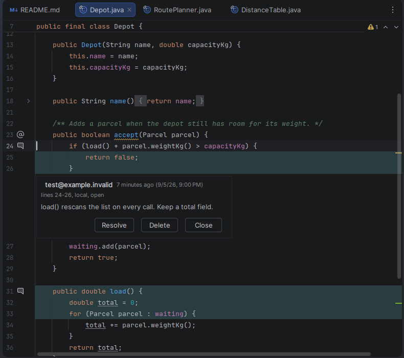
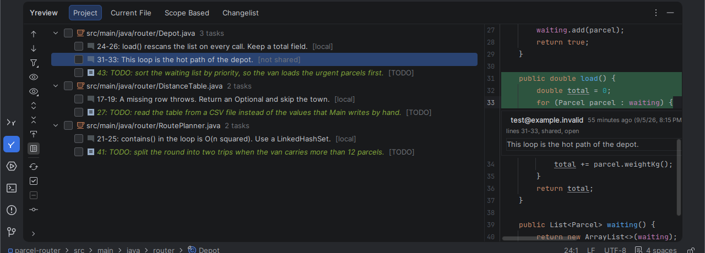
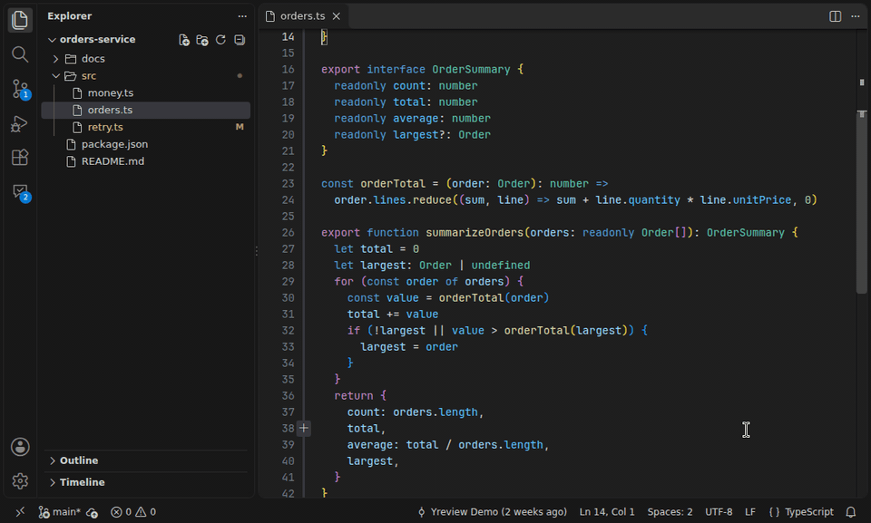
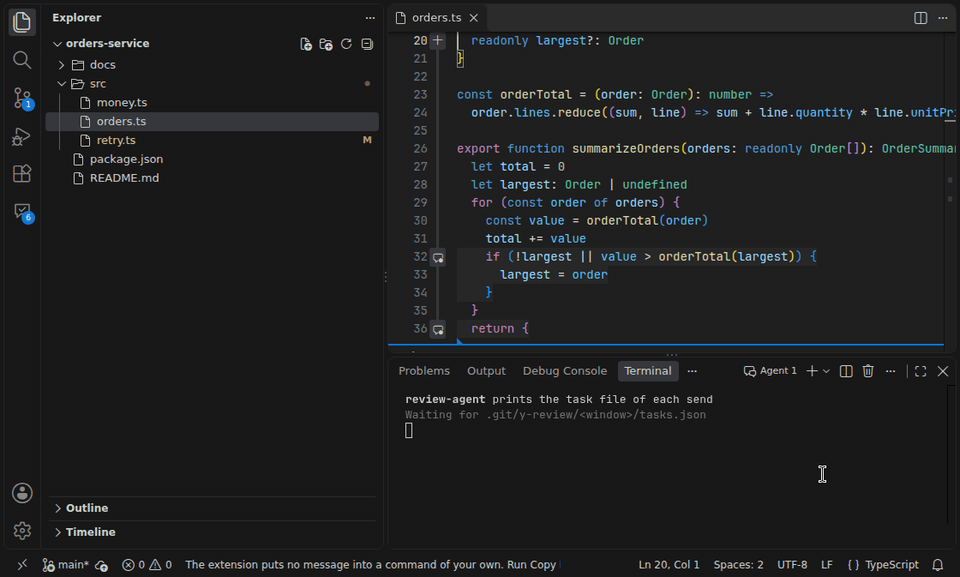
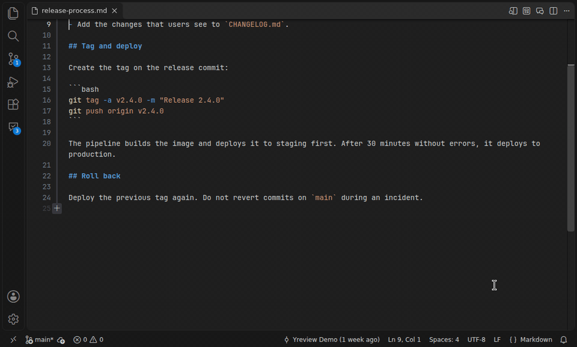
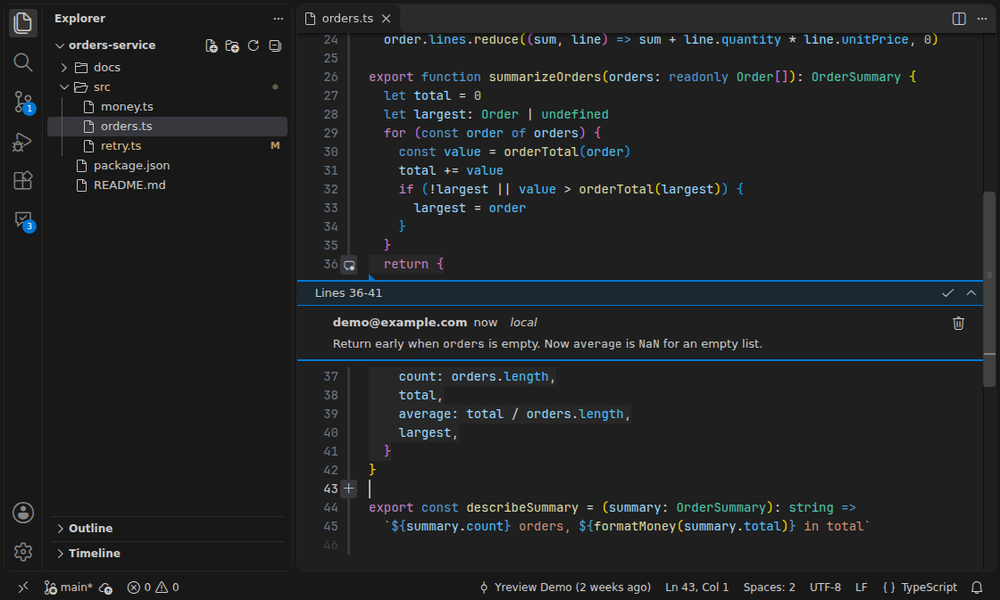
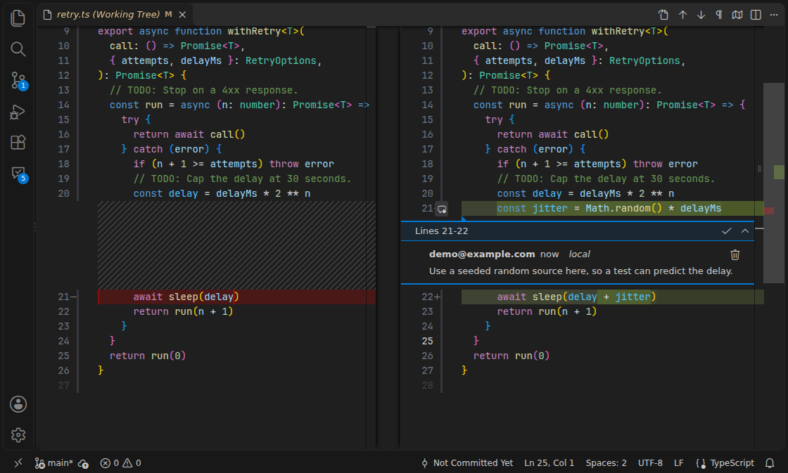
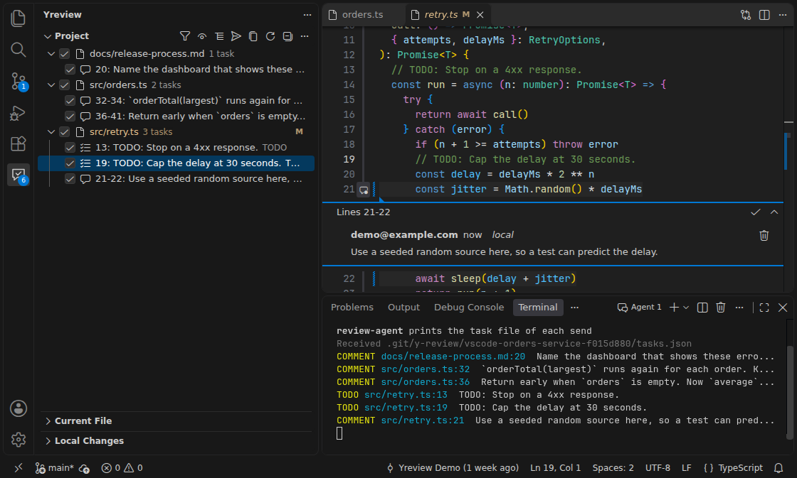
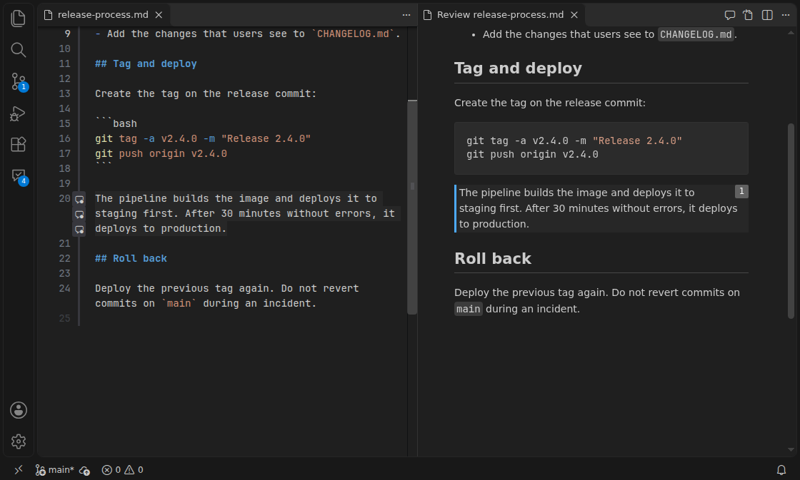
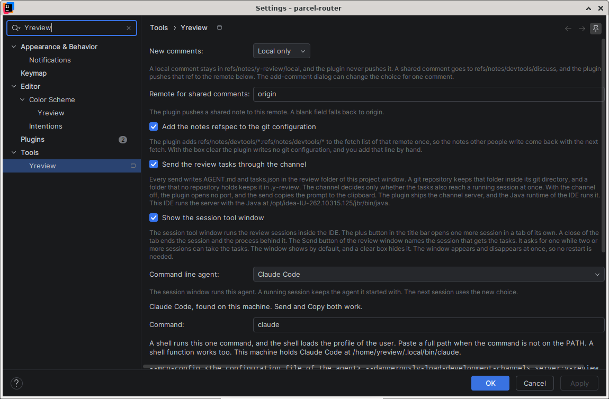

  

# Yreview

Review the code that an AI agent wrote the same way you review a pull request, in IntelliJ
IDEA or in VS Code. Select lines, write a comment, and go on to the next file. Then send the
comments to Claude Code, Codex or another command line agent. When the agent reports a fix,
Yreview marks the comment resolved.

Each comment is a git note in your own repository, so Yreview needs no server and no account.
Nothing leaves your machine, and the author receives no data. See [Privacy](#privacy).

## How it works

1. **Comment.** Select lines in the editor or in a diff and write a comment, in Markdown.
2. **Send to the agent.** One button sends the open tasks to a command line agent. The agent
   runs inside the IDE and gets each task with its file and its lines.
3. **The agent fixes, Yreview resolves.** The agent changes the code and reports each task
   done. Yreview then marks the comment resolved.

Yreview knows nine agents: Claude Code, OpenCode, OpenAI Codex CLI, Antigravity CLI, Gemini
CLI, GitHub Copilot CLI, Cursor CLI, Aider, and Amp. It also runs a command that you type.
The IntelliJ plugin and the VS Code extension read and write the same notes, so one team can
use both.

- Reference: [docs/reference.md](docs/reference.md)
- License: [Apache License 2.0](LICENSE)
- Contribute: [CONTRIBUTING.md](CONTRIBUTING.md)
- Report a problem: https://github.com/yeskiy/yreview/issues
- The steps of a good report: [docs/reference.md](docs/reference.md#report-a-problem)
- Report a security weakness in private: [SECURITY.md](SECURITY.md)

## IntelliJ IDEA

Write a comment on one line or on a range of lines. The action sits in the editor context
menu, in the intention list under Alt and Enter, and on the shortcut Control Shift G. The
same action works on both sides of a diff, and the plugin records the revision of the side
you clicked.

The plugin marks a commented range with a gutter icon and a quiet background. A click on
the icon opens a card inside the editor. The card reads Markdown, and it carries a Resolve
button and a Delete button.

The tool window lists every open comment and every TODO item of the project. It holds four
tabs, Project, Current File, Scope Based, and Changelist. Each tab groups by module or by
directory, filters by kind, and opens a preview beside the tree.

One button hands the open tasks to a command line agent. The agent runs in a tool window of
the IDE, and the settings page names it. Claude Code takes the tasks while the session runs,
through a channel of the plugin. OpenCode takes them over a loopback port of its own. Every
other agent reads them from the clipboard, and from the two files that each send writes in
the git directory. When the agent reports that a task is done, the plugin marks the comment
resolved.

[docs/reference.md](docs/reference.md#where-the-comments-are-stored) says where each comment
goes, what one record holds, and every file the plugin writes.

## VS Code

Select lines and press Ctrl+Alt+G (Cmd+Alt+G on macOS). Write the comment and save it. The
thread shows on the lines, in a file or on either side of a diff.

The Yreview container in the activity bar lists the open comments and TODO items in three
views: Project, Current File, and Local Changes. Check the tasks, then click Send Review Tasks
to the Agent. The agent runs in a terminal of VS Code.

The review preview renders a Markdown file, for example a plan that an agent wrote. Select text
in the preview to comment on its source lines.

| A comment thread                                                 | A comment in a diff                                         |
|------------------------------------------------------------------|-------------------------------------------------------------|
|   |  |
| **The task views**                                               | **The review preview**                                      |
|        |  |

[vscode/README.md](vscode/README.md) holds the full guide of the extension: keys, settings,
and every place it writes.

## Features of the IntelliJ plugin

**The comment**

- Write a comment on one line, or on a range of lines.
- Write a comment on either side of a diff. The plugin records the revision of the side
  you clicked.
- Start the action from the editor context menu, or from the intention list under Alt and
  Enter.
- The shortcut Control Shift G starts the same action.
- A gutter icon and a quiet background mark a commented range.
- A card opens inside the editor. The card reads Markdown, and it carries a Resolve button
  and a Delete button.
- Comments of earlier commits follow their lines. A comment whose lines changed shows as
  outdated with its original text, and a comment of a removed file shows in the task views
  as "file removed".

**The storage**

- The plugin stores each comment as a git note in your own repository, in the git-appraise
  format.
- The plugin needs no server and no account.
- A local comment and a shared comment go to separate note refs.
- The plugin pushes the shared note ref to your git remote.
- A file that no git repository covers still takes a comment, also a file outside the
  project. The plugin keeps that comment in the nearest `.y-review` folder, and it moves the
  records into the git notes after a repository with a commit covers the folder.

**The task list**

- The tool window lists every open comment and every TODO item of the project.
- An open file outside the project adds one more branch, with the tasks of the open files only.
- The window holds four tabs, Project, Current File, Scope Based, and Changelist.
- Each tab groups by module or by directory, filters by kind, and opens a preview pane.

**The command line agent**

- One button hands the open tasks to a command line agent.
- The agent runs in a tool window of the IDE.
- Claude Code takes a task while the session runs, through a channel of the plugin.
- OpenCode takes a task over a loopback port of its own.
- Every other agent reads the tasks from the clipboard, and from the files `AGENT.md` and
  `tasks.json`.
- The plugin marks a comment resolved when the agent reports that the task is done.

**The report**

- One action copies a diagnostic report of the plugin.
- Another action opens a filled issue form after a crash of the IDE.
- Nothing leaves your machine, and the plugin sends no measurement of any kind.

## Command line agents

The settings page lists nine agents: Claude Code, OpenCode, OpenAI Codex CLI,
Antigravity CLI, Gemini CLI, GitHub Copilot CLI, Cursor CLI, Aider, and Amp. The page also
runs a command that you type, and it runs nothing at all after you choose No agent.

| Agent              | How the tasks reach it                                   |
|--------------------|----------------------------------------------------------|
| Claude Code        | A channel of the plugin, while the session runs          |
| OpenCode           | A loopback port of its own                               |
| OpenAI Codex CLI   | The clipboard, and the files `AGENT.md` and `tasks.json` |
| Antigravity CLI    | The clipboard, and the files `AGENT.md` and `tasks.json` |
| Gemini CLI         | The clipboard, and the files `AGENT.md` and `tasks.json` |
| GitHub Copilot CLI | The clipboard, and the files `AGENT.md` and `tasks.json` |
| Cursor CLI         | The clipboard, and the files `AGENT.md` and `tasks.json` |
| Aider              | The clipboard, and the files `AGENT.md` and `tasks.json` |
| Amp                | The clipboard, and the files `AGENT.md` and `tasks.json` |
| Another agent      | The clipboard, and the files `AGENT.md` and `tasks.json` |
| No agent           | The clipboard, and the files `AGENT.md` and `tasks.json` |

[docs/reference.md](docs/reference.md#what-the-plugin-runs) says what the plugin runs for
each agent, and which flags it adds.

## Requirements

| Item                 | Version                             | Needed                                                                              |
|----------------------|-------------------------------------|-------------------------------------------------------------------------------------|
| IntelliJ IDEA        | 2026.2 or 2026.3, build 262 to 263  | Yes. The plugin declares build 263.* as its upper limit.                            |
| Git                  | Any current version, on the PATH    | Yes. The plugin runs the `git` program of your machine.                             |
| A command line agent | Any current version                 | No. Without one every comment feature works, and only the review session stays out. |

The plugin depends on the bundled Git plugin. It needs no Node.js and no account.

## Install

**From the JetBrains Marketplace.** Open the
[plugin page](https://plugins.jetbrains.com/plugin/34134-yreview) and press Install. You can
also search for `Yreview` under Settings, Plugins, Marketplace. Restart the IDE after the
install.

**From an archive.** Download `y-review-<version>.zip` from the
[releases page](https://github.com/yeskiy/yreview/releases). Open Settings, Plugins, press
the gear icon, then Install Plugin from Disk. Pick the archive, then restart the IDE.

**From source.** Read [CONTRIBUTING.md](CONTRIBUTING.md). One command builds the archive.

**VS Code.** Install Yreview from the
[VS Code Marketplace](https://marketplace.visualstudio.com/items?itemName=yeskiy.yreview), or
search for `Yreview` in the Extensions view. Editors that use Open VSX get it from
[Open VSX](https://open-vsx.org/extension/yeskiy/yreview). The extension needs VS Code 1.101 or
later and git 2.24 or later.

CI tests the extension in VS Code on Windows, in Remote-SSH, WSL and Dev Containers windows,
and in VSCodium and Windsurf. In Cursor 3.30, it installs and activates, and 6 of the 11 checks
pass. CI cannot run the other 5, because a new Cursor profile opens a sign-in screen. The
[check table](CONTRIBUTING.md#for-maintainers-the-remote-check-of-the-vs-code-extension) gives
each check and each editor version.

## Settings

Open Settings, Tools, Yreview. In VS Code, run Yreview: Open Settings.

[docs/reference.md](docs/reference.md#settings-reference) holds every setting, its default,
and what it does.

## Privacy

Nothing leaves your machine. The plugin has no server, and the author receives nothing.

The plugin never sends:

- the text of a comment,
- the name or the address of an author,
- the content of a file, a path, or a repository name,
- a token, a key, or a password,
- a usage count, a crash report, or any other measurement.

The plugin opens one port on `127.0.0.1` and nothing else. Two things reach the network,
and you start both.

1. The git push of a shared comment. It goes to your own git remote, and it carries the
   note ref only.
2. The command line agent, when you start a review session. That agent talks to its own
   service under its own settings and its own account. The plugin starts the program and
   adds no data of its own to that traffic.

Read [SECURITY.md](SECURITY.md) for the full list of what the plugin touches.

## License

Apache License 2.0. See [LICENSE](LICENSE) for the full text and [NOTICE](NOTICE) for the
third-party components the archive carries.
