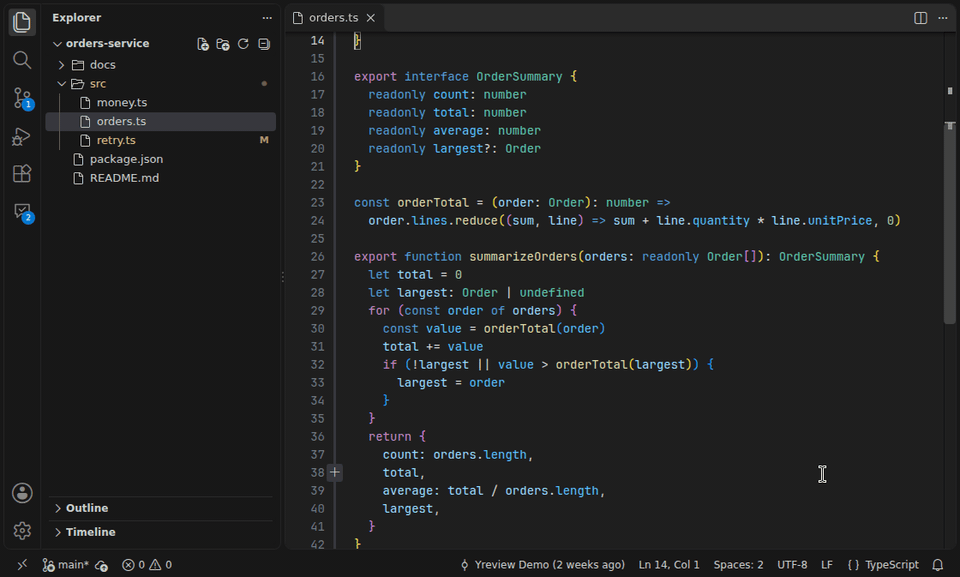
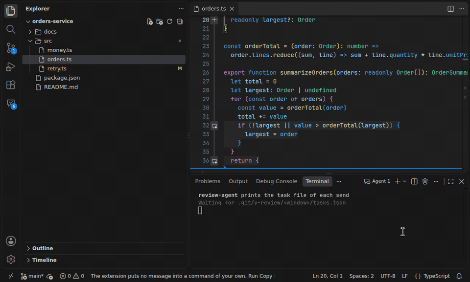
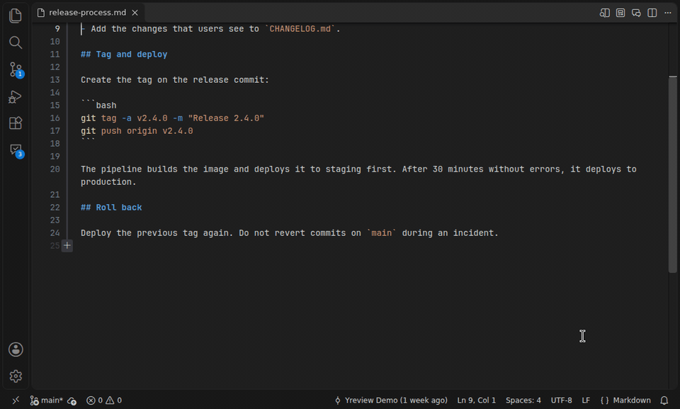
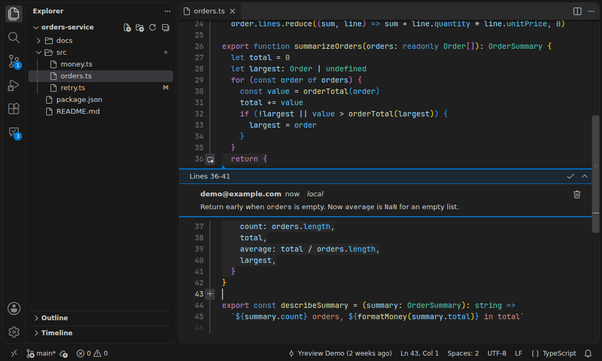
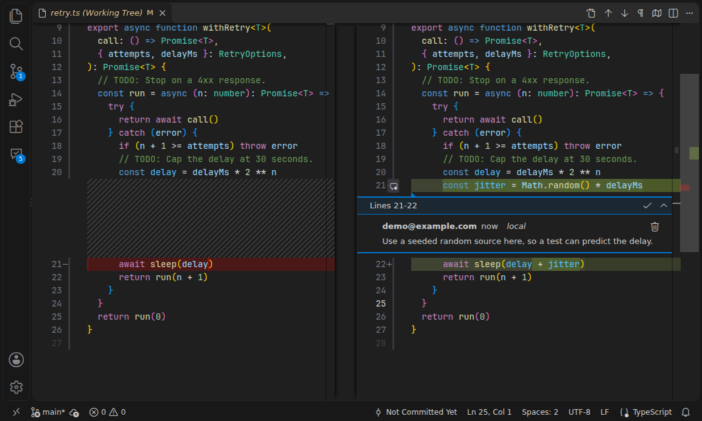
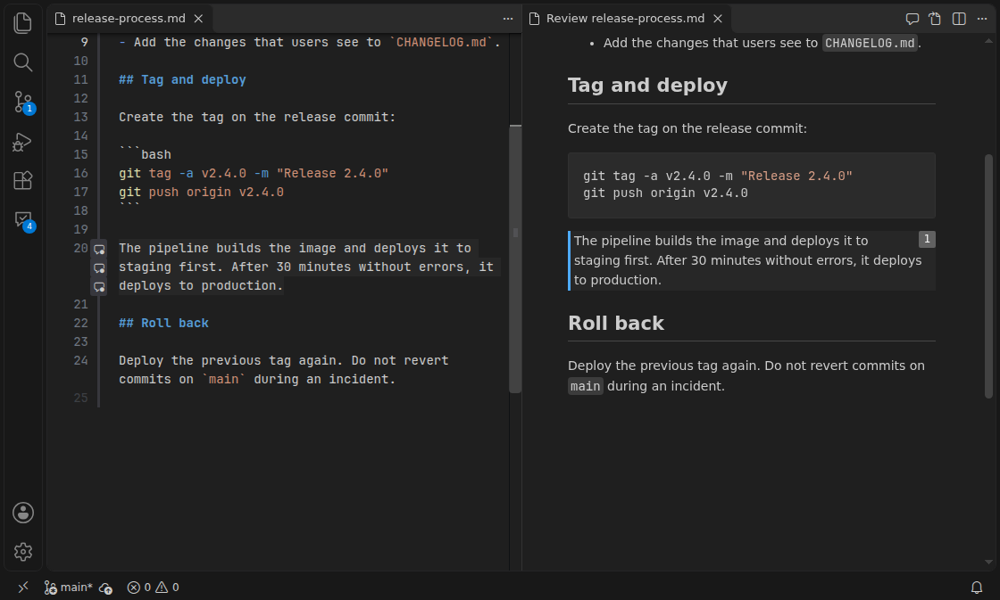
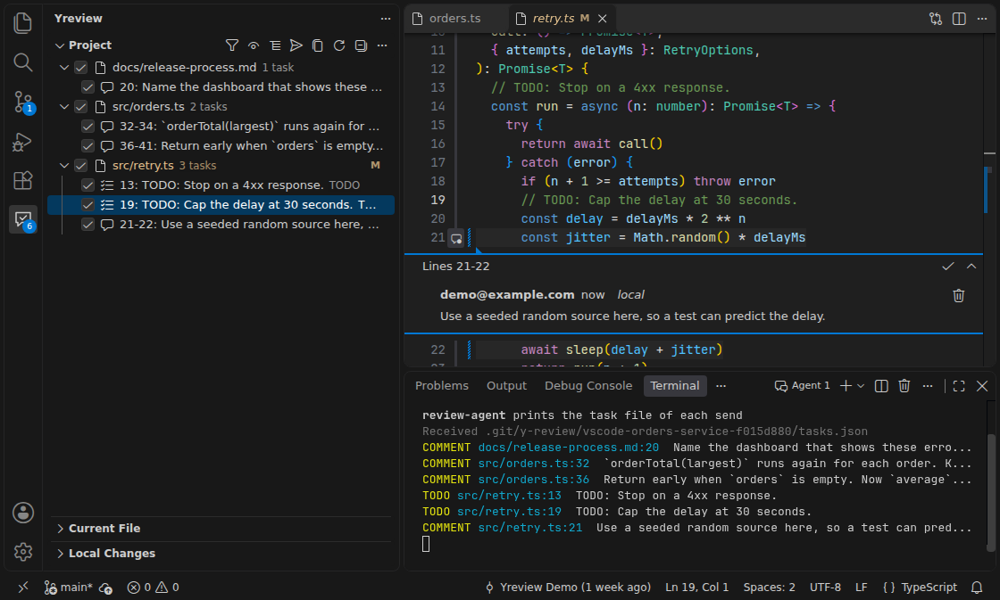

<p align="center">
  
</p>

# Yreview

Review the code that an AI agent wrote the same way you review a pull request. Select lines,
write a comment, and go on to the next file. Then send the comments to Claude Code, Codex
or another command line agent. When the agent reports a fix, Yreview marks the comment resolved.



## How it works

1. **Comment.** Select lines and press Ctrl+Alt+G (Cmd+Alt+G on macOS). Write what is wrong, in
   Markdown, and save.
2. **Send to the agent.** In a Yreview task view, check the tasks or click Check All. Then click
   Send Review Tasks to the Agent. The agent gets each task with its file and its lines.
3. **The agent fixes, Yreview resolves.** The agent changes the code and reports each task done.
   Yreview then marks the comment resolved.

Yreview keeps each comment as a git note in your own repository. It needs no server and no
account.

## Features

- **Comments on any line.** Comment on one line or a range of lines, in a file or on either side
  of a diff in the Source Control view.
- **Comments that follow the code.** When lines above a comment change, the comment moves with
  its lines. When the commented lines change, the thread shows as outdated with the original
  text.
- **Task views.** One activity bar container lists every open comment and TODO item of the
  workspace, of the current file, and of your local changes.
- **Nine agents, or your own command.** Claude Code, OpenCode, OpenAI Codex CLI, Antigravity
  CLI, Gemini CLI, GitHub Copilot CLI, Cursor CLI, Aider, Amp, or a command that you type. The
  agent runs in a terminal of VS Code.
- **Markdown review.** Comment on a rendered Markdown file in the review preview, for example a
  plan that an agent wrote.
- **Local or shared.** A local comment stays on your machine. A shared comment goes to your git
  remote, so your team sees it.





| A comment thread                                                                                                      | A comment in a diff                                                                                                 |
| --------------------------------------------------------------------------------------------------------------------- | ------------------------------------------------------------------------------------------------------------------- |
|  |  |

The same comments show in the [Yreview plugin for IntelliJ IDEA](https://plugins.jetbrains.com/plugin/34134-yreview),
so one team can use VS Code and IntelliJ IDEA together.

## Write a comment

1. Select one or more lines, or put the caret on a line.
2. Press Ctrl+Alt+G (Cmd+Alt+G on macOS), or use Add Review Comment in the editor context menu.
3. Write the comment. Markdown works.
4. Click Save Local or Save Shared, or press Ctrl+Enter (Cmd+Enter on macOS).

To close a new comment box, click Discard or press Escape. Escape asks first when the box has
text.

Click Resolve on a comment to close it. Click Delete to remove it from the notes.

A comment box cannot get the focus on a line that already shows a comment thread. On such a
line, Add Review Comment opens a draft editor beside the file. Write the comment in the draft,
then click Save Local or Save Shared in the title bar, or press Ctrl+Enter. When you close a
draft tab that has text, VS Code asks you to save it. Save writes the comment with the first
button of the comment box (setting `yreview.newComments`). Don't Save discards it.

### Ctrl+Enter and keymap extensions

A keymap extension can bind Ctrl+Enter to another command in each text editor. For example, the
IntelliJ IDEA Keybindings extension binds it to Go to Declaration. A user key binding wins over
that binding. When Yreview finds such a binding, it offers to add this line to your
`keybindings.json`. Click Add to let Yreview add the line. On macOS, the line uses `cmd+enter`.

```json
{
  "key": "ctrl+enter",
  "command": "editor.action.submitComment",
  "when": "commentEditorFocused && commentController == yreview"
}
```

### Diffs

Open a change in the Source Control view. Both sides of the diff take comments. A comment on the
left side goes to the note of the revision of that side. A comment on the working tree side goes
to the note of HEAD. The thread label shows the revision, for example `Lines 2-2 @4f2c8b1`. Diff
views of other extensions, for example GitLens, take no comments.

### Colors and outdated comments

Text under one open comment gets the color `yreview.commentRangeBackground`. Text under two or
more open comments gets the amber color `yreview.commentOverlapBackground`, and a small number
after its last line shows how many comments cover it. The high contrast themes show an outline in
the color `yreview.commentOverlapBorder`. You can change each color in the setting
`workbench.colorCustomizations`.

The comment box opens on the first line of the commented text. For this reason, the VS Code
Comments view shows only the first line of each comment.

Yreview shows the open comments of every commit, not only those of HEAD. When the commented lines
change, the thread label starts with `Outdated`, and the lines get the color
`yreview.commentOutdatedBackground`. When the file is removed, the comment shows only in the task
views, with the words `file removed`. Click that row to open the file as it was at the commit of
the comment.

## The review preview

Run **Yreview: Open Review Preview to the Side**, or click its button in the title bar of a
Markdown file. The review preview renders the file with the engine and the styles of the built-in
Markdown preview. It also loads the preview scripts of your Markdown extensions, for example
Mermaid. It follows your edits before a save, and it scrolls with the source editor.
Double-click a block to show its source line.

Select text in the review preview, then press Ctrl+Alt+G (Cmd+Alt+G on macOS), or right-click and
select Add Review Comment. The comment box opens below the selection, on the source lines of the
selected text. The review preview marks each block that an open comment covers. Click the count
at the right of a block to read its comments, to resolve or delete one, or to show it in the
source.



The built-in Markdown preview also marks the commented blocks. Right-click a selection or a block
and select Add Review Comment. Its title bar button and Ctrl+Alt+G use the selection of the
source, because VS Code gives a key no data from the built-in preview. In the built-in preview,
the comment box opens in the source file.

VS Code 1.146 and later also has a rich Markdown editor. To open it, select Reopen Editor With,
then Markdown Editor. Its title bar button and Ctrl+Alt+G open the box in the source on the
selection of the rich editor. To read that selection, the tab shows the text editor for a moment.

## The task views

Click the Yreview icon in the activity bar. It holds three views of the open review comments and
TODO items:

| View          | Content                                                 |
| ------------- | ------------------------------------------------------- |
| Project       | Every task of the workspace. The badge counts its rows. |
| Current File  | The tasks of the file in the editor                     |
| Local Changes | The tasks of the files that `git status` names          |

Click a row to open the file at the task. A click on a comment row also expands its thread. In a
task view, run Filter and type a glob, such as `src/**/*.ts`, to show the tasks of some files
only.



Yreview finds a TODO item with `git grep` and the patterns of `yreview.todoPatterns`. It reads the
text of the files, so a TODO inside a string also shows. Yreview runs each pattern on each line
with no time limit, so a slow pattern makes the scan slow.

## Requirements

| Item      | Requirement                                                                                                                 |
| --------- | --------------------------------------------------------------------------------------------------------------------------- |
| VS Code   | 1.101 or later                                                                                                              |
| git       | 2.24 or later, on the PATH or in the user setting `git.path`. With an older git, the comment commands stay off.             |
| Folder    | A git repository, or a folder outside git. Outside git, Yreview keeps the comments in `.y-review/` of the workspace folder. |
| Workspace | Trusted. Yreview runs git, and git reads the repository configuration.                                                      |
| File      | Inside a git repository that has at least one commit, or inside a workspace folder                                          |

The extension is also on [Open VSX](https://open-vsx.org/extension/yeskiy/yreview).

CI tests Yreview in VS Code on Windows, in Remote-SSH, WSL and Dev Containers windows, and in
VSCodium and Windsurf. In Cursor 3.30, Yreview installs and activates, and 6 of the 11 checks
pass. CI cannot run the other 5, because a new Cursor profile opens a sign-in screen. The
[check table](https://github.com/yeskiy/yreview/blob/main/CONTRIBUTING.md#for-maintainers-the-remote-check-of-the-vs-code-extension)
gives each check and each editor version.

In a remote window, Yreview runs on the remote host. git, the review bridge, the agent terminal
and the files under `~/.y-review/` are then on the remote host. The issue form opens in the
browser of your local machine. The Markdown preview loads the Yreview marks and the line script
only when the built-in Markdown extension runs on the same host as Yreview.

## Settings

Run Yreview: Open Settings to see every setting. Run Yreview: Choose Agent to see the agents of
this machine and what each one supports.

| Setting                    | Default                     | Effect                                                         |
| -------------------------- | --------------------------- | -------------------------------------------------------------- |
| `yreview.newComments`      | `local`                     | The button that the comment box shows first                    |
| `yreview.remote`           | `origin`                    | The remote that gets the shared comments                       |
| `yreview.writeRefspec`     | `true`                      | After a share, ask before Yreview adds the notes fetch refspec |
| `yreview.editorMarks`      | `true`                      | Show the threads open and color the commented lines            |
| `yreview.channel`          | `true`                      | Open the review bridge, so an agent session gets tasks live    |
| `yreview.intellijKey`      | `false`                     | Also bind Ctrl+Shift+G, the IntelliJ key                       |
| `yreview.todoPatterns`     | `\btodo\b.*`, `\bfixme\b.*` | The TODO patterns of the task views                            |
| `yreview.todoFilters`      | none                        | Named sets of TODO patterns for the Filter button              |
| `yreview.agent`            | none                        | The command line agent of the review sessions                  |
| `yreview.agentCommands`    | none                        | The command of each agent, by agent id                         |
| `yreview.autoStartSession` | `true`                      | Start a session when the Yreview Session panel opens           |
| `yreview.sessionLocation`  | `panel`                     | Where the terminal of a new session opens: `panel` or `editor` |

To make the session panel larger, use the Maximize Panel Size command of VS Code.

## What Yreview writes

| Place                                                 | When                                                                                                                             |
| ----------------------------------------------------- | -------------------------------------------------------------------------------------------------------------------------------- |
| `refs/notes/y-review/local`                           | You save a local comment                                                                                                         |
| `refs/notes/devtools/discuss`, and a push of that ref | You save a shared comment                                                                                                        |
| `remote.<name>.fetch` in `.git/config`                | You click Add in the question after a share                                                                                      |
| `.y-review/notes/` in the workspace folder            | You save a comment on a file outside every git repository                                                                        |
| `<git dir>/y-review/migrated-<time>`                  | A repository with a commit now holds that folder. Yreview copies the comments into the git notes, then moves the old folder here |

Yreview changes no file of your working tree, except the folder `.y-review/` of a workspace
folder outside git.

Do not open one folder outside git in two editors at the same time, for example two VS Code
windows, or VS Code and IntelliJ IDEA. Each editor locks the comment file only inside its own
process, so one of two parallel writes can get lost.

## Privacy

Yreview sends no telemetry. It sends data only with the git push of a shared comment, to the
remote that you chose. The log (Yreview: Show Log) removes your folders, remote addresses, mail
addresses and secret values from each line.

The diagnostic report and the issue form remove every path of your machine before you see them.
They also remove every remote address, every mail address and every token.

## Report a problem

Run Yreview: Copy Diagnostic Report and paste the text into an
[issue](https://github.com/yeskiy/yreview/issues). The report holds versions, switches, counts,
states and the last 50 records of this window. It holds no comment text, no author, no path of
your machine, no remote address and no token. Read it before you paste it.

When a command fails, the error message has a Report button. The button opens a new issue form
in your browser with the error and the versions. Nothing goes anywhere until you press Submit.

Run Yreview: Show Log to see the log of the extension. To attach the log files of VS Code, run
Developer: Export Logs, or run Developer: Open Logs Folder and copy the files.

A crash of the extension host itself makes no report. VS Code starts the host again and shows
its own message.

## Read the notes yourself

    git notes --ref refs/notes/y-review/local show <commit>
    git notes --ref refs/notes/devtools/discuss show <commit>
